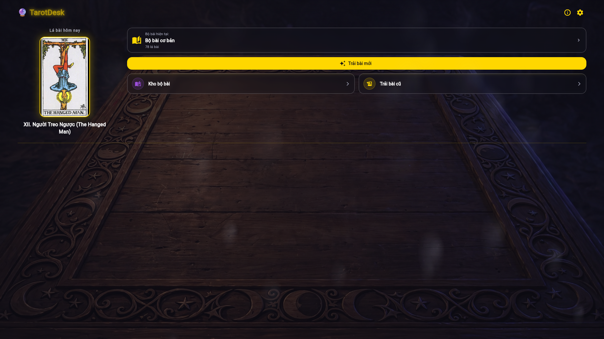
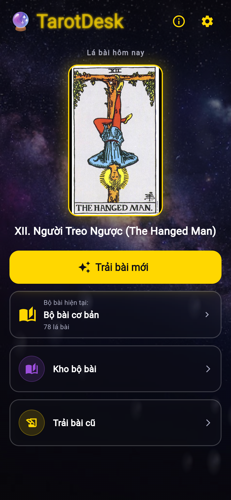

# TarotDesk

TarotDesk là nơi bạn lưu trữ, sắp xếp và tập luyện với bộ bài Tarot của mình.

**TarotDesk không bói toán.** App không đọc bài thay bạn và không thay thế bộ bài vật lý — ý nghĩa của một lá bài đến từ việc bạn học, bạn cảm và bạn suy ngẫm. Trải bài thật là khi bạn cầm lá bài trên tay, xào bài, rút bài, đặt bài lên bàn.

## Dùng thử ngay

Mở app trên trình duyệt, không cần cài đặt: **https://neito112.github.io/TarotDesk/**

Hướng dẫn sử dụng chi tiết (15 slide, có ảnh thật từng bước): **https://neito112.github.io/TarotDesk/guide/**

## Ảnh chụp thực tế

### Màn hình chính — máy tính

### Màn hình chính — điện thoại

> Ảnh chụp các màn hình còn lại (trải bài, chọn lá, kho bộ bài, lịch sử, cài đặt, nhạc, giới thiệu) sẽ được bổ sung dần.

## Tính năng

- **Lá bài ngày** — mỗi tài khoản có một lá riêng mỗi ngày, cho bất ngờ riêng của từng người. Chạm vào lá để đọc toàn bộ ý nghĩa. Lá tự đổi khi sang ngày mới.
- **Trải bài mới** — bàn trải bài vẽ tay theo phong cách 3D: mặt bàn gỗ, khăn phẳng có thể đổi, phụ kiện (đá thạch anh, quả cầu, hương trầm, nến) bám sát mặt bàn và đổi được ngay trong lúc trải bài hoặc trong Cài đặt. Xấp bài đặt ở một góc bàn; chạm vào xấp bài để rút lá, lá vừa rút bay lên sân khấu cùng ý nghĩa của nó; khay bên dưới giữ tất cả các lá đã rút. Mọi thao tác đều có chuyển động mượt.
- **Kho bộ bài** — xem trước các bộ bài có sẵn, tập luyện trong app rồi hãy quyết định mua bản vật lý ("Thử trước, mua sau"). Thêm bộ bài của riêng bạn, sửa lá bài, gửi bộ bài để chia sẻ cho mọi người dùng (chờ quản trị duyệt).
- **Lịch sử trải bài** — các lần trải bài đã lưu, mở lại bất cứ lúc nào.
- **Đăng nhập Google + đồng bộ** — dữ liệu bộ bài và lịch sử của bạn được lưu theo tài khoản, dùng máy nào cũng thấy; làm việc offline vẫn bình thường. Bộ bài bạn chia sẻ sẽ hiện cho mọi người dùng; tài khoản quản trị duyệt các bộ bài được gửi lên.
- **Nhạc huyền bí** — 5 bản nhạc có sẵn, hoặc dán link YouTube để phát nhạc của riêng bạn trong lúc trải bài.
- **Ngôn ngữ** — giao diện dùng được bằng tiếng Việt, English, 中文, 한국어, 日本語 (đổi trong Cài đặt). Ý nghĩa các lá bài giữ nguyên tiếng Việt.
- **Giới thiệu & Hướng dẫn** — giải thích TarotDesk là gì, 6 bước sử dụng, và link tới bộ slide hướng dẫn chi tiết.

## Cách dùng

1. Mở https://neito112.github.io/TarotDesk/ và đăng nhập bằng Google (hoặc chọn "Dùng offline" để dùng ngay không cần tài khoản).
2. Xem **Lá bài ngày** của bạn, chạm vào lá để đọc ý nghĩa.
3. Bấm **Trải bài mới**, chạm vào xấp bài để rút từng lá, chạm vào lá trên sân khấu để thu xuống khay, chạm vào lá trong khay để đưa lên sân khấu.
4. Vào **Kho bộ bài** để xem, thêm hoặc gửi bộ bài; vào **Lịch sử** để mở lại các lần trải bài đã lưu.
5. Bấm nút ⚙ để đổi khăn, phụ kiện, nhạc, ngôn ngữ.

## Công nghệ

- **Flutter web (Dart)** — giao diện chạy trên trình duyệt, tương thích điện thoại Android, iPad và PC.
- **GitHub Pages** — hosting tĩnh cho app và bộ slide hướng dẫn.
- **Cloudflare Worker + D1** — đăng nhập Google, đồng bộ dữ liệu theo tài khoản, bộ bài chung và duyệt bộ bài gửi lên.
- **sqflite (local)** — dữ liệu trên máy, dùng offline bình thường.

## Đóng góp & ủng hộ

- Mã nguồn: https://github.com/Neito112/TarotDesk
- Nếu thấy hữu ích, bạn có thể mời mình một tách cà phê bằng mã QR trong màn **Giới thiệu** của app (VietQR / BIDV).
